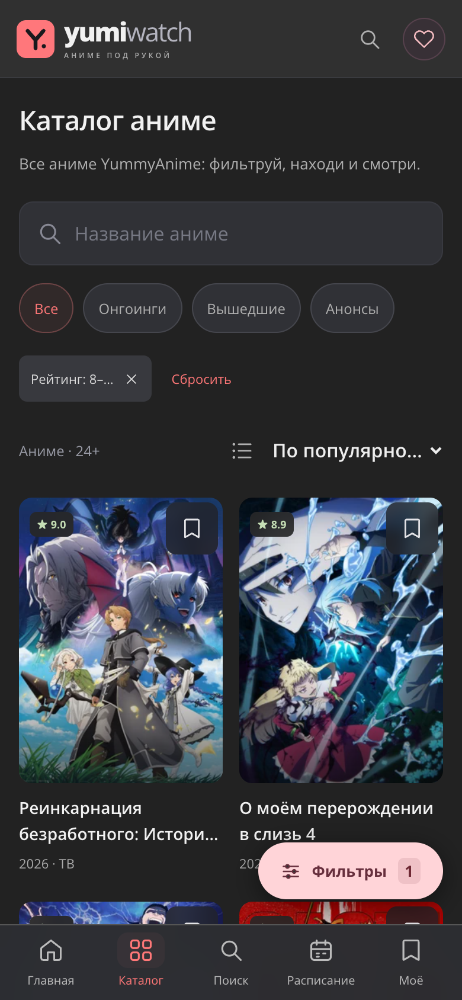
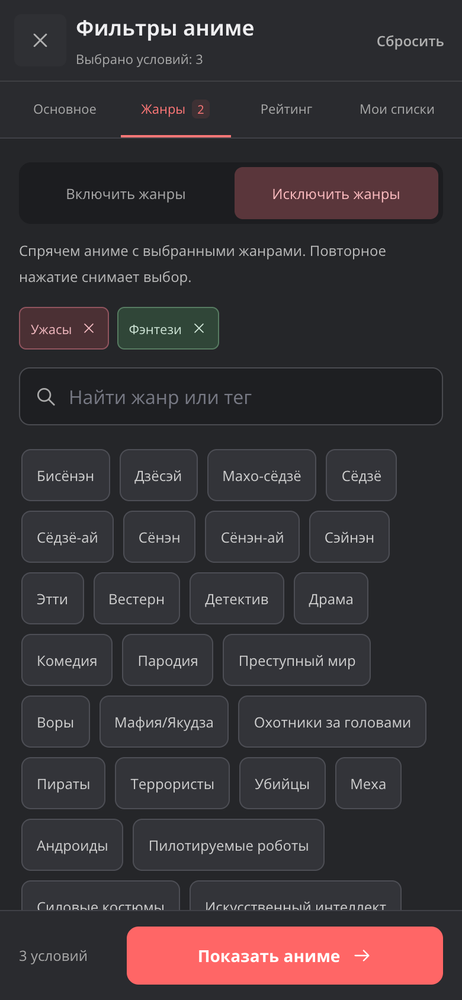
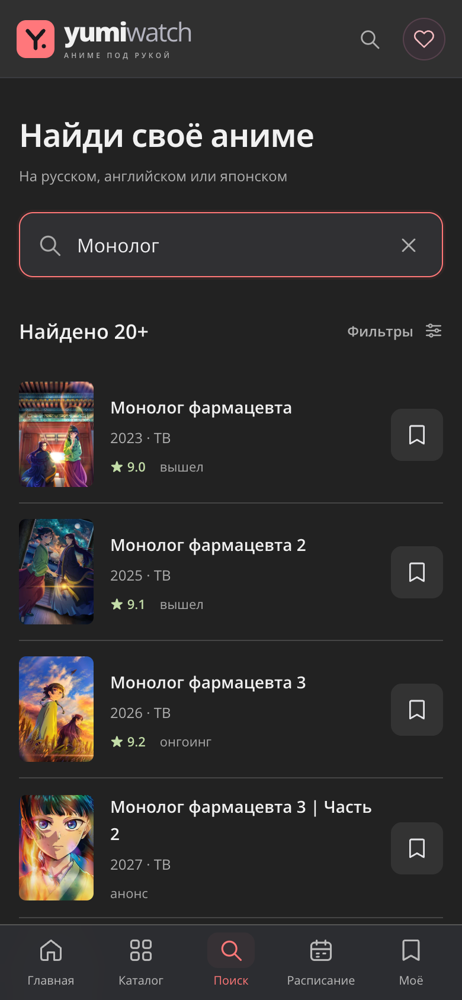
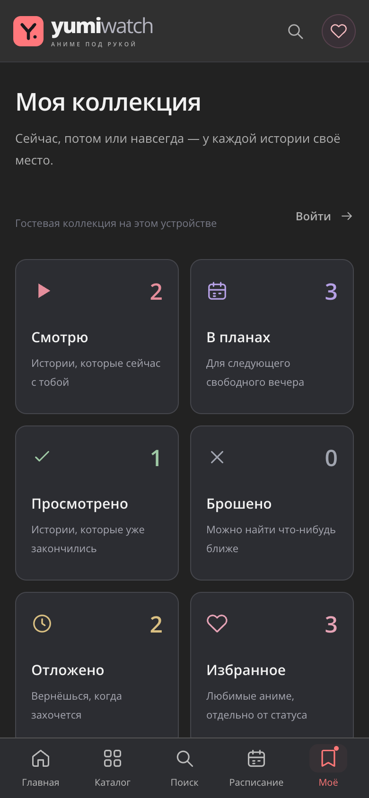
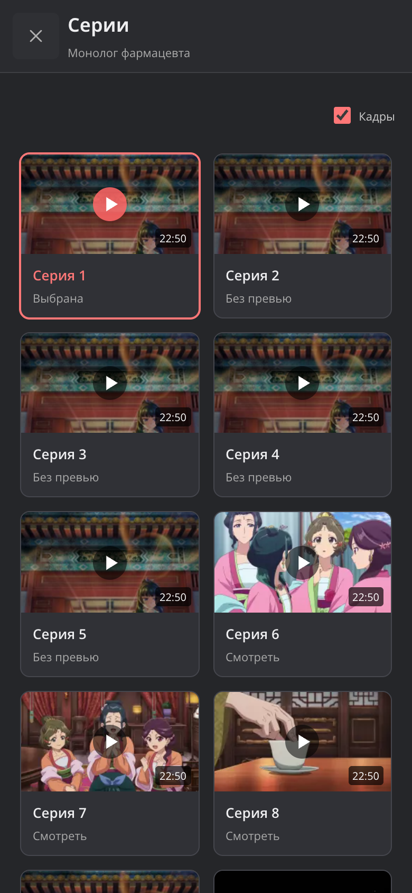
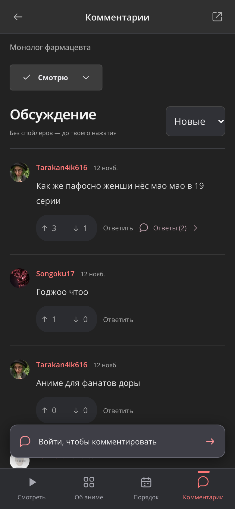

<p align="center">
  
</p>
<h1 align="center">YumiWatch</h1>
<p align="center">YummyAnime с удобным интерфейсом для телефона.</p>
<p align="center">
  <a href="https://vicimpa.github.io/yumiwatch/"><strong>Открыть приложение →</strong></a>
  · <a href="#как-это-выглядит">Скриншоты</a>
  · <a href="#запустить-у-себя">Запуск</a>
</p>
<p align="center"><sub>Preact · TypeScript · PWA · GitHub Pages</sub></p>

Найти аниме на вечер, добавить его в планы, а завтра продолжить с нужной секунды. YumiWatch собирает эти привычные вещи в небольшое приложение, которым удобно пользоваться одной рукой.

Телефон здесь — основной экран. Просмотр, описание и комментарии открываются отдельно, длинные списки прокручиваются вместе со страницей, а фильтры применяются одной кнопкой.

## Как это выглядит

<table>
  <tr>
    <td align="center"><strong>Каталог</strong></td>
    <td align="center"><strong>Фильтры</strong></td>
    <td align="center"><strong>Поиск</strong></td>
  </tr>
  <tr>
    <td></td>
    <td></td>
    <td></td>
  </tr>
  <tr>
    <td align="center"><strong>Свои списки</strong></td>
    <td align="center"><strong>Выбор серии</strong></td>
    <td align="center"><strong>Обсуждение</strong></td>
  </tr>
  <tr>
    <td></td>
    <td></td>
    <td></td>
  </tr>
</table>

Скриншоты настоящего приложения на экране 390 × 844. Для примера гостевая коллекция заполнена аниме из публичного каталога. Переснять их можно командой `npm run screenshots`.

## Что уже умеет

- **Находить.** Поиск по названию, недавние запросы, сетка и список. Все 103 жанра и тега из API, включение и исключение жанров, сезоны, статусы, форматы, перевод, возраст и диапазоны рейтинга, годов и числа серий.
- **Раскладывать по полочкам.** «Смотрю», «В планах», «Просмотрено», «Брошено», «Отложено», избранное, история и подписки на озвучки. Статус выбирается на странице аниме; любимые можно сохранить независимо от него.
- **Помнить просмотр.** Сохранённая серия, озвучка, время и прогресс. Реальные превью серий, отдельный выбор озвучки и плеера, соседние серии и автопереход. У совместимых плееров — перемотка и пропуск опенинга.
- **Обсуждать.** Комментарии YummyAnime, сортировка, оценки и отдельные ветки ответов. Спойлеры раскрываются по нажатию, незаконченный комментарий остаётся черновиком.
- **Работать быстрее при возвращении.** Каталог сразу показывает сохранённую выдачу и обновляет её в фоне. Позиция страницы и загруженные страницы сохраняются при возврате из поиска или карточки аниме. Постеры и аватарки кэшируются отдельно.
- **Жить на главном экране.** PWA устанавливается на телефон, учитывает вырезы экрана и экранную клавиатуру. Новая версия устанавливается по нажатию, чтобы обновление не прерывало просмотр.

## Свой аккаунт или гостевой режим

Можно войти с почтой и паролем YummyAnime: личные списки и история загрузятся из аккаунта, а изменения сохранятся на сервере. Пароль отправляется напрямую в Yani и не хранится в приложении. Запоминание входа включается отдельно.

Без входа списки и история остаются на этом устройстве. Гостевая коллекция и коллекция аккаунта хранятся раздельно.

**Вход через сам сайт пока не подключён.** Проверены Swagger и клиент YummyAnime: поддерживаемого внешнего OAuth-потока с возвратом в стороннее приложение не найдено. Социальные входы на сайте есть, но открытие сайта не передаёт сессию в YumiWatch. [Подробности проверки →](docs/development.md#проверка-входа-через-сайт)

## Установить на телефон

1. Открой [YumiWatch](https://vicimpa.github.io/yumiwatch/).
2. На **iPhone**: Safari → «Поделиться» → «На экран Домой». На **Android**: меню Chrome → «Установить приложение».

Для видео и синхронизации аккаунта нужен интернет. После первого посещения оболочка, сохранённый публичный каталог и загруженные картинки доступны без сети. Сторонние плееры и их возможности зависят от поставщиков.

## Запустить у себя

Нужен Node.js 22.12 или новее.

```sh
npm ci
npm run dev
```

Публичный токен своего приложения Yani укажи в `.env.local`:

```dotenv
VITE_YANI_APPLICATION_TOKEN=публичный_токен_приложения
```

Его можно получить в [настройках приложений YummyAnime](https://yummyani.me/dev/applications). Это публичный ключ приложения, который попадёт в сборку. Пользовательский токен и пароль сюда не подходят.

```sh
npm test               # проверки логики и компонентов
npm run build          # production-сборка в dist/
npm run preview        # проверка сборки и PWA
npm run screenshots    # мобильные скриншоты и headless-проверка
```

Для скриншотов по умолчанию используется установленный Google Chrome. [Настройка Chromium и описание проверки →](docs/development.md#проверка-интерфейса)

## Опубликовать на GitHub Pages

```sh
npm run deploy
```

Скрипт запускает тесты, собирает приложение и отправляет готовые файлы в `gh-pages`. Нужны авторизация в `gh` и доступ к репозиторию. В настройках Pages выбери **Deploy from a branch → gh-pages → / (root)**.

Для GitHub Actions есть [готовый workflow](deployment/pages-workflow.yml). Маршруты используют hash, поэтому обновление страницы работает и на статическом хостинге. [Подробности публикации →](docs/development.md#github-pages)

## Под капотом

Один небольшой бандл на Preact, локальные шрифты и прямые запросы к [Yani API](https://api.yani.tv/swagger). Своего сервера нет.

| Данные | Где остаются |
| --- | --- |
| Публичная выдача каталога | До 35 ответов в браузере; обновление в фоне при открытии и восстановлении сети |
| Постеры и аватарки | Раздельные кэши: до 80 постеров и 64 аватарок |
| Гостевые списки и история | `localStorage` этого устройства |
| Личные ответы API | Только в памяти вкладки, вне публичного кэша |
| Токен входа | `sessionStorage`; с «Оставаться в аккаунте» — `localStorage` |
| Видео | В стороннем плеере, без сохранения в кэш приложения |

[API, сессии, ограничения плееров и структура проекта →](docs/development.md)

---

YumiWatch — независимый клиент, не официальное приложение YummyAnime. Каталог, постеры, кадры и ссылки на плееры предоставляет YummyAnime / Yani. Open Sans используется по [SIL Open Font License](public/OFL.txt).
